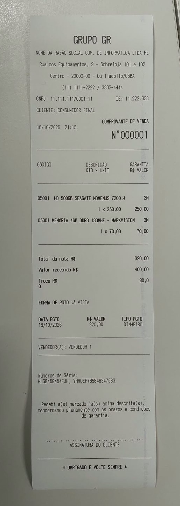
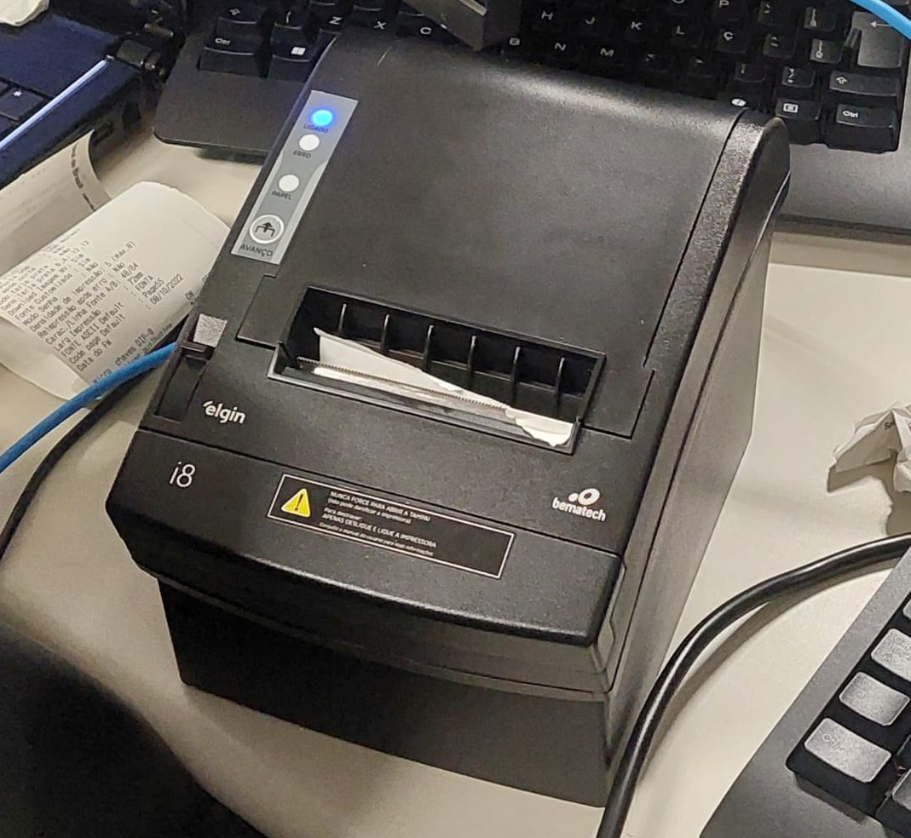

 -
 -

# Recibo Java - Impressora Térmica

**Unidade Curricular 12 - SENAC**

> **Data:** 14 e 16 de outubro de 2026

**Aluno:** Anderson Wilmer Yapiticona Flores  
**Professor:** José de Assis

---

## Introdução

Projeto desenvolvido durante o curso Técnico em Informática do SENAC, com o objetivo de praticar a comunicação entre um programa Java e uma impressora térmica Elgin i8 pela rede.

### Resultado da atividade

*Recibo gerado pelo programa Java.*

*Impressora térmica Elgin i8 utilizada na atividade.*

---

## Tecnologias utilizadas

- Java
- Eclipse IDE
- TCP/IP com Socket
- OutputStream para envio dos dados
- Comandos ESC/POS para formatação e controle da impressora

---

## Funcionalidades

- Impressão de cabeçalho e informações comerciais
- Impressão automática da data e hora
- Formatação de texto com negrito, alinhamento e tamanho da fonte
- Exibição de produtos, valores, total, pagamento e troco
- Avanço e corte do papel

---

## Como executar

1. Abra o projeto Java no Eclipse.
2. Configure o endereço IP da impressora no código.
3. Certifique-se de que o computador e a impressora estejam conectados à rede e que a porta de impressão utilizada esteja acessível.
4. Execute a classe `Recibo`.

O código-fonte está disponível [aqui](Código/Recibo.java).

**Observação:** o programa foi desenvolvido para uma impressora térmica compatível com os comandos ESC/POS utilizados. O funcionamento pode variar conforme o modelo e a configuração do equipamento.

---

## Aprendizados

A atividade permitiu praticar a comunicação por rede em Java, o envio de dados em bytes, a formatação de texto com ESC/POS e a geração de data e hora.
